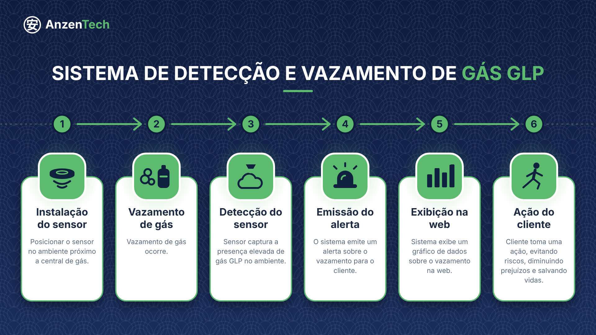
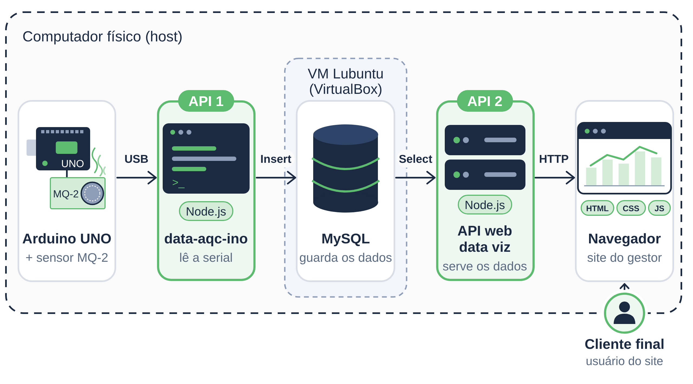
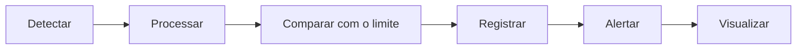

<div align="center">


**Sistema de Monitoramento e Detecção de Vazamento de Gás GLP**

*Vamos com tudo!*


</div>

---

## Sumário

- [Sobre o projeto](#sobre-o-projeto)
- [Funcionalidades](#funcionalidades)
- [Visão de negócio](#visão-de-negócio)
- [Arquitetura](#arquitetura)
- [Tecnologias](#tecnologias)
- [Hardware](#hardware)
- [Instalação](#instalação)
- [Como usar](#como-usar)
- [Escopo e limitações](#escopo-e-limitações)
- [Estrutura do repositório](#estrutura-do-repositório)
- [Equipe](#equipe)
- [Licença](#licença)

---

## Sobre o projeto

O GLP é muito usado em cozinhas industriais, e um vazamento pode passar despercebido: a percepção pelo cheiro depende de haver alguém no local, da ventilação e da intensidade do vazamento. Como o gás é mais pesado que o ar, ele tende a se acumular perto do piso e, havendo uma fonte de ignição, pode causar incêndio ou explosão.

A **AnzenTech** é um protótipo acadêmico que monitora continuamente a presença de gases inflamáveis, registra as leituras e emite um alerta quando o limite definido é ultrapassado. O objetivo é ser uma camada **complementar** de monitoramento, e não substituir normas, inspeções ou equipamentos profissionais.

**Quem usa:** o gestor da cozinha, responsável pela operação e pela segurança. Ele entra no painel com login e recebe os alertas.

> Projeto da disciplina de Pesquisa e Inovação, curso de Análise e Desenvolvimento de Sistemas da SPTech (Grupo 3, 1ADS-A).

---

## Funcionalidades

| Recurso | O que entrega |
|---|---|
| Leitura atual | Valor do sensor em ppm, com indicação de status |
| Histórico | Gráficos das leituras ao longo do tempo (Chart.js) |
| Eventos | Registro consultável, com data, hora e valor |
| Alerta | Aviso quando o limite do protótipo é ultrapassado |

O painel também ajuda o gestor a agir: mostra o procedimento a seguir quando o alerta dispara e permite consultar o histórico para identificar vazamentos pequenos e recorrentes (sinal de desgaste de mangueira, regulador ou conexão).

---

## Visão de negócio

<div align="center">



</div>

O diagrama mostra a jornada em 6 passos: instalação do sensor, vazamento de gás, detecção pelo sensor, emissão do alerta, exibição na web e ação do cliente.

---

## Arquitetura

<div align="center">



</div>

O fluxo segue da esquerda para a direita:

| # | Etapa | Onde roda | O que faz |
|---|---|---|---|
| 1 | **Arduino UNO R3 + MQ-2** | Hardware, ligado por USB ao host | O sensor detecta gases inflamáveis e o Arduino compara a leitura com o limite |
| 2 | **data-aqc-ino** (API 1) | Computador físico (host) | Lê a porta serial (USB) e grava as leituras no MySQL |
| 3 | **MySQL** | VM Lubuntu (VirtualBox) | Guarda leituras e eventos |
| 4 | **API web data viz** (API 2) | Computador físico (host) | Consulta o banco e entrega os dados ao site |
| 5 | **Navegador** | Computador físico (host) | Site em HTML, CSS, JS e Chart.js usado pelo gestor |

**Protocolos entre as etapas:** USB (Arduino → API 1), Insert (API 1 → MySQL), Select (MySQL → API 2) e HTTP (API 2 → navegador).

**Lógica de funcionamento**



---

## Tecnologias

| Camada | Tecnologias |
|---|---|
| Hardware | Arduino UNO R3, sensor MQ-2, Arduino IDE (C/C++) |
| Dados | MySQL, Lubuntu, VirtualBox |
| Aplicação | data-aqc-ino, API web data viz, Node.js, HTML, CSS, JavaScript, Chart.js |
| Gestão | GitHub, Trello |

---

## Hardware

### Componentes

- Arduino UNO R3
- Sensor de gás MQ-2
- Cabo USB (liga o Arduino ao computador)

### Sobre o sensor MQ-2

O MQ-2 é um sensor semicondutor de baixo custo para gases inflamáveis e fumaça. O fabricante informa uma faixa de detecção de aproximadamente **300 a 10.000 ppm**, com boa sensibilidade ao propano. Por responder a vários gases, a leitura **não identifica exclusivamente o GLP**.

Como referência técnica, o limite inferior de explosividade (LEL) do propano é de cerca de 2,1% em volume, o equivalente a **21.000 ppm** (1% = 10.000 ppm). Esse valor é só uma referência: o limite de alerta do protótipo é **experimental** e definido nos testes.

### Posicionamento do sensor

O GLP é mais pesado que o ar, então o sensor fica **embaixo, perto do piso**.

| Critério | Recomendação |
|---|---|
| Altura | 10 a 30 cm do piso (padrão de 30 cm) |
| Distância do risco | Perto de botijão, regulador ou fogão, sem ficar sobre chamas |
| Ventilação | Longe de janelas, portas e exaustores |
| Coifa | Nunca sob a coifa de extração |
| Proteção | Longe de gordura, vapor, água, poeira e calor |
| Quantidade | 1 sensor por ambiente de risco; mais de um em cozinhas maiores |

O MQ-2 também reage à fumaça e a vapores (como álcool), o que pode gerar falso alerta. Ele precisa de **pré-aquecimento e calibração no local** antes dos testes.

---

## Instalação

### Pré-requisitos

- Arduino IDE
- VirtualBox com uma VM Lubuntu
- Node.js no computador físico (host)
- Navegador atualizado

### Passo a passo

**1. Clonar o repositório**

```bash
git clone https://github.com/siratsuti-sptech/Anzen-Tech.git
cd Anzen-Tech
```

**2. Gravar o Arduino**

1. Ligue o MQ-2 ao Arduino UNO (pino de sinal: `[A0]`).
2. Abra o sketch da pasta `arduino/` na Arduino IDE.
3. Selecione a placa **Arduino UNO** e a porta USB, e faça o upload.

**3. Preparar o banco na VM**

1. Na VM Lubuntu, instale e inicie o MySQL.
2. Crie o banco e as tabelas de leituras e eventos.
3. Configure a rede da VM para que o host consiga acessar o MySQL, por exemplo com redirecionamento da porta 3306 no VirtualBox.

**4. Iniciar a API 1 (data-aqc-ino)**

No host, configure a porta serial do Arduino e os dados de conexão com o MySQL da VM e inicie a aplicação:

```bash
npm install
npm start
```

**5. Iniciar a API 2 (API web data viz)**

No host, configure a conexão com o MySQL e inicie a aplicação:

```bash
npm install
npm start
```

**6. Abrir o site**

Abra o site da pasta `AnzenTech-Site/` no navegador (por exemplo, o `index.html`).

---

## Como usar

1. Com o Arduino ligado e as duas APIs em execução, abra o site e entre com o login.
2. Acompanhe a **leitura atual** em ppm e o **histórico** nos gráficos.
3. Consulte os **eventos** registrados quando precisar de data, hora e valor.
4. Se um alerta disparar, siga o procedimento padrão:
   1. Feche o registro do botijão ou da central.
   2. Não acione interruptores nem equipamentos elétricos.
   3. Ventile o ambiente.
   4. Evacue o local.
   5. Ligue para o Corpo de Bombeiros (**193**).

---

## Escopo e limitações

**Faz parte do projeto:** leitura contínua do sensor, processamento, comparação com o limite, armazenamento do histórico, painel web, alerta com registro do evento e testes em condições controladas.

**Não faz parte do projeto:**

- Reparo ou alteração da rede de GLP, de fogões, fornos ou de qualquer equipamento a gás.
- Controle automático de válvulas ou equipamentos (fechar o registro é uma ação manual do responsável).
- Sistemas de combate a incêndio ou contenção automática de vazamentos.
- Certificação como equipamento de segurança profissional.
- Testes com grandes vazamentos reais.

**Limitações do protótipo**

- O MQ-2 responde a vários gases, então a leitura não identifica só o GLP.
- Os valores em ppm dependem de calibração e das condições do ambiente (ventilação, temperatura, umidade, outros gases).
- Os limites de alerta são **parâmetros experimentais**, não limites oficiais de segurança.
- O sistema não garante a detecção de todos os vazamentos e **não deve ser o único mecanismo de segurança** da cozinha. Ele não substitui inspeções, manutenção nem a NR-20.

---

## Estrutura do repositório

```text
Anzen-Tech/
├── AnzenTech-Site/        # Site (HTML, CSS, JS e Chart.js)
├── Planilha_de_Riscos/    # Planilha de riscos do projeto
├── arduino/               # Código do Arduino UNO + MQ-2
├── entregaveis/           # Documentação e diagramas
├── .gitignore
├── LICENSE
└── README.md
```

---

## Equipe

**Grupo 3, 1ADS-A, SPTech**

- Flávio Sandri Caputo
- Kauã Hideaki Siratsuti
- Nicollas Martins Candido
- Pedro Nunes Pereira
- Pietro Giuliani Da Silva
- Zanee Lopes Pereira

---

## Licença

Distribuído sob a licença descrita no arquivo [LICENSE](LICENSE).

---

<div align="center">

**Prevenir é mais seguro do que remediar.**

</div>
